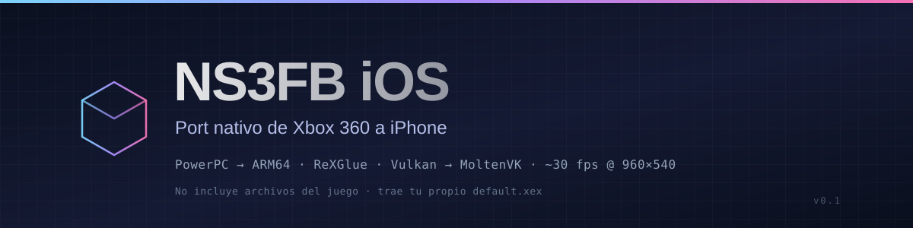

<div align="center">



<br>

**Naruto Shippuden: Ultimate Ninja Storm 3 Full Burst** corriendo nativo en iPhone.

Recompilación estática PowerPC → ARM64 · Vulkan sobre Metal · ~30 fps

<br>

[](#-requisitos-mínimos)
[](#-requisitos-mínimos)
[](https://github.com/rexglue/rexglue-sdk)
[](https://github.com/KhronosGroup/MoltenVK)
[](#-estado)
[](LICENSE)

<sub><a href="README.md">Read in English</a></sub>

[Estado](#-estado) · [Requisitos](#-requisitos-mínimos) · [Qué aportas tú](#-lo-que-tienes-que-aportar-tú) · [Compilar](#-compilar) · [Rendimiento](#-rendimiento) · [Depurar](#-depurar)

</div>

---

> [!IMPORTANT]
> **Este repositorio no contiene nada del juego.** Ni el ejecutable, ni datos, ni audio,
> ni vídeos, ni texturas. Solo el toolchain que convierte **tu** copia en una app de iOS.
> El `default.xex` lo aportas tú, desde tu propio disco, y no se sube nunca al repo.

> [!WARNING]
> Proyecto de fans, sin ánimo de lucro, sin relación con Bandai Namco, CyberConnect2,
> VIZ Media ni Microsoft. **No es publicable en la App Store.** Solo sideload.

---

## 📱 Requisitos mínimos

| | Mínimo | Recomendado |
|---|---|---|
| **Dispositivo** | iPhone arm64 con iOS 16.3 (desde iPhone XS/XR) | iPhone 12 o posterior |
| **iOS** | 16.3 | 17 o posterior |
| **RAM** | 4 GB — verificado en iPhone 11 | 6 GB o más |
| **Almacenamiento libre** | 10 GB | 15 GB (7 GB son datos del juego) |
| **Firma** | Apple ID gratis (caduca a los 7 días) | SideStore / AltStore / certificado |
| **Extras** | Tu `default.xex` NTSC-U | Mando Bluetooth |

> [!NOTE]
> **Probado en iPhone 11 (A13).** El resto es extrapolación honesta, no una garantía.
> En dispositivos de 3 GB puede faltar espacio de direcciones si el perfil de firma no
> incluye `extended-virtual-addressing` — no está probado con este juego.

**Firma:** el `.ipa` sale sin firmar. Con Apple ID gratuito necesitas re-firmar cada
7 días; con SideStore/AltStore la renovación es automática.

---

## ✅ Estado

Jugable de principio a fin en iPhone 11, a ~30 fps estables (960×540, GPU ~27 ms/frame).

| Parte | Estado |
|---|---|
| Arranque, menús, selección de personaje y escenario | ✅ |
| VS Battle, práctica, HUD, partículas, audio | ✅ |
| Jutsus definitivos, awakening ("modo bestia"), fin de combate | ✅ |
| Pantalla de resultados y de Ryos | ✅ |
| Modo historia | ✅ |
| Controles táctiles + mando Bluetooth (Xbox/PlayStation/MFi) | ✅ |
| Game Mode, icono propio | ✅ |
| 1280×720 | ❌ ~18 fps — techo del SDK, ver [Rendimiento](#-rendimiento) |
| Detalles visuales menores | ⚠️ sin catalogar |

---

## 📦 Lo que tienes que aportar tú

| Qué | Detalle | ¿Va al repo? |
|---|---|---|
| `default.xex` | 11 218 944 bytes · SHA-1 `f7ad65e2…55e9f` · tu disco **NTSC-U** | ❌ nunca |
| `data/` + `datafb/` | ~7 GB de datos del juego | ❌ nunca |
| Firma de la app | SideStore, AltStore, Sideloadly o tu certificado | — |
| Un Mac **o** una cuenta de Codemagic | Solo para compilar | — |

El hash es obligatorio: el código se recompila desde un ejecutable concreto.
Si no coincide, el port no arranca — no es configuración, es otro binario.

| Campo | Valor |
|---|---|
| Title ID | `4E4D085C` |
| Media ID | `2576927D` |
| `default.xex` SHA-1 | `f7ad65e26a00df6c29c9d34b291819593e455e9f` |
| `default.xex` tamaño | 11 218 944 bytes |

```bash
extract-xiso -x "Naruto Storm 3 Full Burst.iso" -d app/game
shasum -a 1 app/game/default.xex
# f7ad65e26a00df6c29c9d34b291819593e455e9f
```

`app/game/` está en `.gitignore`: lo que pongas ahí **no** se commitea por accidente.

---

## 🗂️ Qué hay en este repositorio

```
ns3fb-ios/
├── app/
│   ├── CMakeLists.txt              target iOS, embebe las dylibs del SDK
│   ├── game/                       ← TU extracción va aquí (ignorado por git)
│   ├── generated/                  ← código generado por el codegen (ignorado)
│   ├── platform/ios/               Info.plist, entitlements, iconos, memext/
│   └── src/
│       ├── main.cpp                entry point
│       └── ns3fb_app.h             rutas iOS, defaults de cvars, marcadores
├── ci/
│   ├── patches.list                los 11 parches del SDK, en orden
│   ├── rexglue-*.patch             los parches
│   ├── entrypoint_seeds.txt        193 funciones que el codegen no descubre
│   └── game/                       ← vacío: aquí no viaja el ejecutable
├── scripts/
│   ├── 00-fetch-sdk.sh             clona el SDK y aplica el parche iOS + ci/
│   ├── 01-codegen.sh               recompila TU default.xex a C++
│   ├── 02-seed-entrypoints.py      aplica entrypoint_seeds.txt al manifest
│   ├── 03-build-app.sh             compila la app (y genera los iconos)
│   └── make-ipa.sh                 empaqueta NS3FB.ipa
├── tools/xex/                      unxex.py y find_callback_thunks.py
├── docs/                           TROUBLESHOOTING, PERF_MATRIX, RAM_EXTENSION_PLAN
├── codemagic.yaml                  CI sin Mac (iOS unsigned IPA)
└── LICENSE / CREDITS.md
```

---

## 🔨 Compilar

### Opción A — en tu Mac

Requiere macOS 13+, Xcode 15+, `cmake`, `ninja`, `python3`.

```bash
chmod +x scripts/*.sh
cp -R /ruta/a/tu/extraccion/* app/game/    # default.xex + data/ + datafb/
./scripts/00-fetch-sdk.sh                  # ~30-40 min la primera vez
./scripts/01-codegen.sh                    # recompila el .xex (~20-30 min)
./scripts/03-build-app.sh
./scripts/make-ipa.sh                      # NS3FB.ipa sin firmar
```

### Opción B — en la nube, sin Mac (Codemagic)

El repo trae `codemagic.yaml` con el workflow `ios-unsigned`. **Un repo público no puede
compilar aquí**: el CI necesita el `default.xex` en el árbol de trabajo y ese archivo no
está en el repo. La forma correcta es trabajar sobre una **copia privada**:

```bash
git clone https://github.com/juanxd2006/ns3fb-ios.git
cd ns3fb-ios
# GitHub: Settings → Danger Zone → Change visibility → Private

cp "/ruta/a/tu/extraccion/default.xex" ci/game/default.xex
git add -f ci/game/default.xex        # -f: está en .gitignore a propósito
git commit -m "Game executable for CI (copia privada)"
git push
```

Luego conecta el repo en Codemagic (*Add application* → GitHub) y lanza `ios-unsigned`.

| Aspecto | Realidad |
|---|---|
| Build frío | 45–60 min (compila el SDK entero) |
| Build con caché caliente | 20–30 min |
| Tocar cualquier archivo de `ci/` | Invalida la caché del SDK → build frío |
| Artefacto | `NS3FB.ipa` sin firmar |
| Workflow `sdk-cache` | Solo calienta la caché del SDK (~2 min si ya está) |

En el log debe aparecer `==> Cached ReXGlue SDK found, skipping build`.
Si no aparece, estás pagando el build frío otra vez.

---

## 📲 Instalar y firmar

El `.ipa` sale **sin firmar**:

- **SideStore / AltStore** — firma con tu Apple ID, renovación automática cada 7 días.
- **Sideloadly** — Apple ID gratis, caduca a los 7 días.
  *Advanced Options → Enable File Sharing*.
- **Certificado de desarrollador** propio:
  ```bash
  PROFILE=~/ruta/al.mobileprovision ./scripts/sign-and-install.sh
  ```

> [!TIP]
> Para que **cambie el icono** hay que desinstalar antes de reinstalar: iOS cachea el
> icono por bundle ID.

### Copiar los datos del juego al iPhone

1. Abre la app una vez y ciérrala (crea las carpetas).
2. Finder → tu iPhone → **Archivos** → *En mi iPhone / NS3FB*:

```
NS3FB/
├── game/          ← default.xex, data/, datafb/
├── userdata/      ← saves y logs (automático)
└── ns3fb.toml     ← ajustes (automático, editable)
```

Opcional: `scripts/inject-game-files.sh` mete los datos dentro del `.ipa`
(→ ~3-5 GB por instalación). Para iterar sobre la app, mejor sin datos.

---

## ⚙️ Ajustes

`NS3FB/Documents/ns3fb.toml`, editable desde la app Archivos; aplica al reiniciar.
Esta es la configuración medida:

```toml
video_mode_width = 960
video_mode_height = 540
present_effect = "cas"          # o "fsr"
present_cas_additional_sharpness = 0.4
msaa_override = 0
direct_host_resolve = false
execute_unclipped_draw_vs_on_cpu = true
anisotropic_override = 0
present_dither = false
clear_memory_page_state = false
vulkan_submit_on_primary_buffer_end = false
async_shader_compilation = false
readback_resolve = "none"
readback_memexport = false
texture_cache_memory_limit_soft = 320
texture_cache_memory_limit_hard = 640
texture_cache_memory_limit_rtt = 24
framerate_limit = 30            # el original está atado a 30
vsync = true
```

El juego original corre a 30 fps fijos: a 60 va al doble de velocidad.

---

## 📊 Rendimiento

iPhone 11 (A13), Metal HUD:

| Resolución | GPU (ms) | Compute (ms) | Fragment (ms) | FPS |
|---|---|---|---|---|
| 1280×720 | 54–55 | 28,5 | 19,0 | 18,2 |
| 960×540 | 22–27 | 10–11 | 11–13 | 30 |

A 720p el **51 % del frame** son los compute shaders de volcado de EDRAM
(~129 compute encoders por frame): coste fijo por resolve, no ajustable por
configuración. Por eso 720p está descartado salvo que se escriban shaders de
resolve directo (proyecto aparte).

**Ya medido y descartado**, para que nadie lo repita:

- `msaa_override = 1` no baja el compute (28,05 → 26,39 ms) y **corrompe la imagen**.
- `direct_host_resolve` no acelera: `TryResolveCopyDirectly()` acaba en
  `return DumpRenderTargets(...)`. Mismo stub en D3D12.
- `execute_unclipped_draw_vs_on_cpu_with_scissor` no mueve el compute.
- Ruta `fsi` es más lenta en este juego. `keep_pass_open` da ~7 %, descartado.

---

## 🔍 Depurar

Todo el diagnóstico es por log, sin recompilar. En `NS3FB/Documents/` basta duplicar y
renombrar archivos:

| Marcador | Efecto |
|---|---|
| `diag_on.txt` | Enciende `NS3FB-*` (>200 líneas/s, el juego deja de responder) |
| `msaa1.txt` / `msaa2.txt` / `msaa4.txt` | Fuerza `msaa_override` |
| `ztest_off.txt` / `blend_off.txt` | Overrides de diagnóstico |
| `mvk.txt` | Líneas `MVK_CONFIG_XXX=valor` |

Los marcadores pisan el `ns3fb.toml`.

### `NS3FB-TRAP` — el bug que queda

```
NS3FB-TRAP 0x825A7258 unregistered guest function, continuing as no-op
```

El juego llamó a una función que el codegen no descubrió (no está en `.pdata`, solo se
alcanza por punteros construidos en runtime) y se ejecutó como no-op. Síntomas típicos:
una animación que se corta, un menú que no avanza, una pantalla que se queda cargando.

Se arregla sembrando la dirección en `ci/entrypoint_seeds.txt` (una por línea,
`0xXXXXXXXX`, con un comentario de fecha y síntoma). **Ya hay 193**; con eso los traps
bajaron de 10 por sesión a 0–4.

```bash
python3 tools/xex/unxex.py app/game/default.xex /tmp/image.bin
python3 tools/xex/find_callback_thunks.py /tmp/image.bin
```

---

## 🧠 Memoria y entitlements

`ns3fb.entitlements` pide `com.apple.developer.kernel.extended-virtual-addressing`: el
mapa de memoria del invitado necesita ~4.5 GB contiguos. Un Apple ID gratuito **no**
concede ese entitlement, así que en dispositivos de 3 GB verás *"not enough free address
space"* salvo con TrollStore, jailbreak o cuenta de pago. Hoy la app usa ~1,33 GB de 3 GB.

`sustained-execution` e `increased-memory-limit` están documentados y **comentados**: con
Apple ID gratis la firma falla si los dejas activos.

---

## ⚖️ Legal

- Proyecto de fans, sin ánimo de lucro. Sin relación con Bandai Namco, CyberConnect2,
  VIZ Media ni Microsoft. *Naruto* y *Naruto Shippuden: Ultimate Ninja Storm 3 Full
  Burst* son marcas y obras de sus titulares.
- Este repositorio **no incluye ni distribuye** archivos del juego. El código generado
  por el codegen es una obra derivada de **tu** `default.xex`: no lo redistribuyas.
- **No abras issues pidiendo o compartiendo archivos del juego.** Se cierran sin respuesta.
- No publicable en la App Store. Solo sideload / TestFlight interno.
- Licencia del código: [LICENSE](LICENSE) · Alcance de esa licencia: [NOTICE.md](NOTICE.md) · Terceros: [CREDITS.md](CREDITS.md)

## 🙏 Créditos

El mérito de que esto sea posible es de **DevZer0D4Y** (capa iOS del SDK ReXGlue),
**ReXGlue**, **Xenia**, **XenonRecomp**, **XenosRecomp** y **MoltenVK**.
Detalle completo en [CREDITS.md](CREDITS.md).

<div align="center">
<sub>Hecho por fans, para fans. Trae tu propio disco.</sub>
</div>
